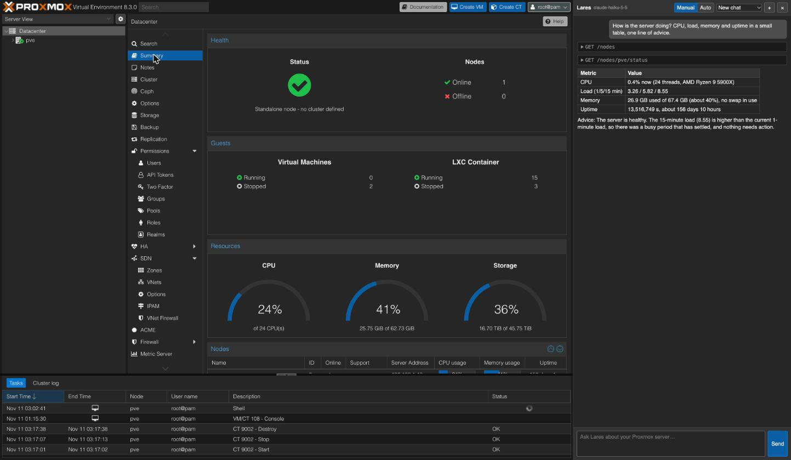

# Lares for Proxmox VE

An AI copilot inside the Proxmox VE web UI. It reads and changes your server through the Proxmox API with **your own login**: nothing more than you can do, and every change asks first unless you choose Auto mode (destructive actions always ask). Bring your own Anthropic or DeepSeek API key.



## Install

1. Download the latest zip from [Releases](../../releases) and unzip it, or clone this repo.
2. Open `chrome://extensions`, enable **Developer mode**, **Load unpacked**, and pick the `extension/` folder.
3. On your Proxmox tab, click the Lares icon → **Enable Lares on this site**, then open **Settings** to add your key.

## Develop

```sh
npm install && npm test && npm run check
```

No build step: `extension/` is what Chrome loads. Safari: `xcrun safari-web-extension-packager extension` (needs Xcode).

Not affiliated with Proxmox Server Solutions GmbH. Proxmox® is their registered trademark. [Privacy](PRIVACY.md) · [MIT](LICENSE)
